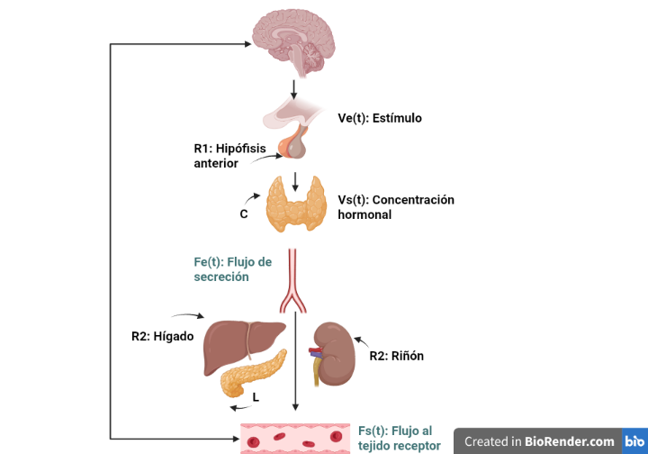
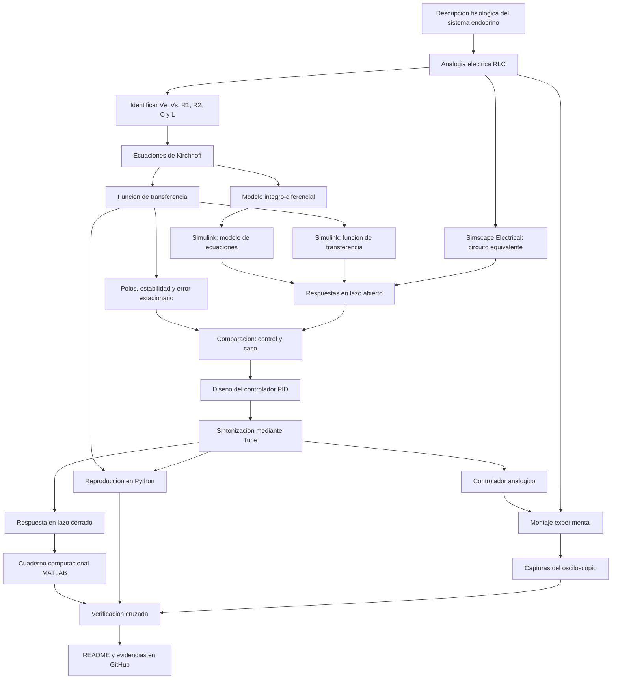

[](https://matlab.mathworks.com/open/github/v1?repo=sarag-hub/MSFP4)

# Práctica 4 — Modelado y control del sistema endócrino

Repositorio académico de la asignatura **Modelado de Sistemas Fisiológicos**, correspondiente al programa de **Ingeniería Biomédica** del Tecnológico Nacional de México / Instituto Tecnológico de Tijuana. Esta práctica integra la interpretación fisiológica, la construcción de circuitos eléctricos equivalentes, el modelado matemático, el análisis temporal y de estabilidad, el diseño de controladores PID, la simulación computacional y la verificación experimental en el Laboratorio de Electrónica.

El caso de estudio representa el **sistema endócrino** mediante un modelo fenomenológico simplificado de segundo orden, compuesto por dos resistencias, una capacitancia y una inductancia. Se busca reproducir y comparar la respuesta de una condición de referencia (**control**) con una condición alterada (**caso**), tanto en lazo abierto como en lazo cerrado, mediante una estrategia de control orientada a reducir las diferencias entre ambas respuestas.

**Docente:** Dr. Paul Antonio Valle Trujillo  
**Correo:** paul.valle@tectijuana.edu.mx  
**Departamento:** Ingeniería Eléctrica y Electrónica  
**Institución:** Tecnológico Nacional de México / Instituto Tecnológico de Tijuana  
**Asignatura:** Modelado de Sistemas Fisiológicos  
**Programa:** Ingeniería Biomédica  
**Estudiante:** Sara Gutiérrez Hernández · 23212734 · l23212734@tectijuana.edu.mx

**Repositorio de la asignatura:** https://github.com/DrPaulValle/MSF-IBF1020  
**Sede:** Blvd. Alberto Limón Padilla s/n, Tijuana, C. P. 22454, B. C., México.

---

<a id="contenido"></a>
## Contenido

1. [Resumen](#resumen)
2. [Competencia y objetivos](#objetivos)
3. [Relación con el temario](#temario)
4. [Modelo físico y analogía eléctrica](#analogia)
5. [Formulación matemática](#modelo)
6. [Análisis temporal y de estabilidad](#analisis)
7. [Señales de entrada y condiciones de simulación](#senales)
8. [Implementación en MATLAB, Simulink y Simscape](#matlab)
9. [Control en lazo cerrado y sintonización PID](#pid)
10. [Reproducción en Python](#python)
11. [Controlador analógico y laboratorio](#laboratorio)
12. [Resultados y verificación cruzada](#resultados)
13. [Flujo de trabajo](#flujo)
14. [Actividades del estudiante](#actividades)
15. [Estructura del repositorio](#estructura)
16. [Requisitos](#requisitos)
17. [Reproducibilidad y entregables](#reproducibilidad)
18. [Referencias](#referencias)

---

<a id="resumen"></a>
## Resumen

La práctica tiene como propósito **desarrollar un procedimiento de modelado, análisis, simulación y control** del sistema endócrino mediante una analogía eléctrica de segundo orden. El modelo representa de manera simplificada los procesos de secreción, transporte, almacenamiento y respuesta hormonal utilizando dos resistencias $R_1$ y $R_2$, una capacitancia $C$ y una inductancia $L$. A partir de las leyes de Kirchhoff se formulan las ecuaciones integro-diferenciales del circuito, se obtiene su función de transferencia mediante la transformada de Laplace y se analizan los polos, la estabilidad y el error en estado estacionario.

Se comparan dos condiciones: un **individuo de referencia (control)** y un **caso simulado de respuesta hormonal alterada**, representado mediante la modificación simultánea de la capacitancia $C$ y la resistencia $R_2$. Se aplica una entrada escalón unitario para evaluar las respuestas en lazo abierto y posteriormente se incorpora un **controlador PID con retroalimentación negativa**, sintonizado mediante la herramienta Tune de Simulink, con la finalidad de aproximar la respuesta del caso a la del control. Los modelos se implementan en MATLAB/Simulink y Simscape Electrical, mientras que sus resultados se reproducen mediante Python para realizar una verificación computacional cruzada.

La práctica integra la **implementación experimental en el Laboratorio de Electrónica**, mediante la construcción de los circuitos eléctricos equivalentes correspondientes al control y al caso, así como del controlador analógico. Las respuestas en lazo abierto y en lazo cerrado se registran mediante osciloscopio y se contrastan con las simulaciones desarrolladas en MATLAB/Simulink, Simscape Electrical y Python, considerando las características dinámicas de los componentes y las diferencias entre los resultados computacionales y experimentales.

Esta práctica corresponde a un ejercicio de **modelado y verificación computacional y experimental**. Su finalidad es interpretar la relación entre los elementos eléctricos y los procesos fisiológicos que representan, comparar el comportamiento dinámico de dos condiciones del sistema endócrino y evaluar una estrategia de control clásico. La analogía es de carácter fenomenológico y académico; los valores de sus componentes no representan directamente magnitudes fisiológicas medidas experimentalmente.

**Palabras clave:** sistema endócrino; modelo fenomenológico; circuito RLC; secreción hormonal; controlador PID; MATLAB; Simulink; Simscape Electrical; Python; simulación *in silico*; instrumentación electrónica.

[Volver al contenido](#contenido)

---

<a id="objetivos"></a>
## Competencia y objetivos

### Competencia a desarrollar

Modeliza sistemas fisiológicos mediante analogías eléctricas, ecuaciones diferenciales y funciones de transferencia para analizar su comportamiento dinámico y diseña estrategias de control mediante técnicas de control clásico. En particular, durante esta práctica se interpreta una descripción simplificada de los procesos de secreción, transporte, almacenamiento y respuesta hormonal para construir un circuito eléctrico equivalente de segundo orden. Posteriormente, se compara una condición de referencia (control) con una condición alterada (caso), se diseña un controlador PID y se contrastan los resultados obtenidos mediante modelado analítico, simulación computacional y experimentación en el Laboratorio de Electrónica.

### Objetivo general

Modelar y analizar el comportamiento dinámico del sistema endócrino mediante una representación eléctrica de segundo orden, formulando sus ecuaciones y funciones de transferencia para comparar las condiciones control y caso, diseñar una estrategia de control con retroalimentación negativa y verificar las respuestas obtenidas mediante MATLAB/Simulink, Simscape Electrical, Python y experimentación en el Laboratorio de Electrónica.

### Objetivos específicos

- Interpretar los procesos fisiológicos de secreción, transporte, almacenamiento y respuesta hormonal para establecer su correspondencia con los elementos de un circuito eléctrico equivalente.
- Construir los circuitos correspondientes a las condiciones control y caso, identificando la entrada, la salida, los flujos asociados y los elementos $R_1$, $R_2$, $C$ y $L$.
- Formular las ecuaciones integro-diferenciales del sistema mediante las leyes de Kirchhoff y obtener su función de transferencia aplicando la transformada de Laplace.
- Determinar las funciones de transferencia de ambas condiciones, considerando la modificación simultánea de la capacitancia $C$ y la resistencia $R_2$.
- Calcular el error en estado estacionario y los polos de los modelos para analizar su estabilidad y comportamiento dinámico.
- Elaborar un bosquejo cualitativo de las respuestas temporales a partir del análisis matemático y compararlo con los resultados de las simulaciones.
- Implementar las ecuaciones del sistema, las funciones de transferencia y los circuitos eléctricos equivalentes mediante MATLAB/Simulink y Simscape Electrical.
- Analizar las respuestas en lazo abierto del control y del caso ante una entrada escalón unitario.
- Diseñar un sistema de retroalimentación negativa utilizando la respuesta del control como referencia para el caso y sintonizar un controlador PID mediante la herramienta Tune de Simulink.
- Desarrollar un cuaderno computacional de MATLAB para ejecutar las simulaciones, representar gráficamente las respuestas y almacenar los resultados en formato PDF.
- Reproducir las funciones de transferencia y las respuestas del sistema mediante Python para verificar la consistencia de los resultados computacionales.
- Calcular los componentes del controlador analógico a partir de las ganancias proporcional, integral y derivativa, y construir su representación mediante Simscape Electrical.
- Implementar experimentalmente los circuitos correspondientes al control y al caso, así como el sistema con controlador, utilizando los componentes eléctricos y equipos del Laboratorio de Electrónica.
- Registrar mediante osciloscopio las respuestas en lazo abierto y en lazo cerrado, y comparar los resultados experimentales con las simulaciones computacionales.
- Elaborar un diagrama biológico que relacione los procesos del sistema endócrino con los componentes y variables del circuito eléctrico equivalente.
- Documentar el análisis matemático, los modelos computacionales, las ganancias del controlador, las simulaciones y las evidencias experimentales en un repositorio de GitHub.

[Volver al contenido](#contenido)

---

<a id="temario"></a>
## Relación con el temario

La práctica integra contenidos correspondientes a tres unidades de la asignatura **Modelado de Sistemas Fisiológicos (IBF-1020)**:

| Unidad | Área | Contenidos aplicados |
|---|---|---|
| I | Sistemas de control retroalimentados | Diagramas de bloques, respuesta al escalón, error en estado estacionario y estabilidad |
| II | Modelado matemático | Analogía eléctrica del sistema endócrino, leyes de Kirchhoff, ecuaciones integro-diferenciales y función de transferencia |
| III | Controladores | Diseño, sintonización e implementación de un controlador PID |

El enfoque combina **Ingeniería de Control, Electrónica Analógica, Ciencias de la Computación y Fisiología**, mediante la representación de procesos endócrinos y su análisis matemático, computacional y experimental.

[Volver al contenido](#contenido)

---

<a id="analogia"></a>
## Modelo físico y analogía eléctrica

El sistema endócrino se representa mediante un circuito eléctrico RLC de segundo orden que aproxima los procesos de secreción, transporte, almacenamiento y respuesta hormonal. La entrada $V_e(t)$ representa el estímulo fisiológico, mientras que la salida $V_s(t)$ corresponde al nivel efectivo normalizado de la señal hormonal disponible en el compartimento de interés.

| Variable o componente | Representación eléctrica | Interpretación fisiológica |
|---|---|---|
| $V_e(t)$ | Voltaje de entrada | Estímulo que inicia la secreción hormonal |
| $F_e(t)$ | Corriente de entrada | Flujo de secreción y transporte hormonal |
| $R_1$ | Resistencia | Oposición y pérdidas durante el transporte |
| $C$ | Capacitancia | Almacenamiento temporal de la señal hormonal |
| $L$ | Inductancia | Retardo e inercia de la respuesta del tejido diana |
| $R_2$ | Resistencia | Utilización, disipación o eliminación hormonal |
| $F_s(t)$ | Corriente de salida | Flujo asociado con la respuesta del tejido diana |
| $V_s(t)$ | Voltaje de salida | Nivel hormonal efectivo normalizado |

El circuito considera una fuente $V_e(t)$ conectada en serie con $R_1$. En el nodo de salida se encuentra una capacitancia $C$ conectada a la referencia, en paralelo con una rama formada por $L$ y $R_2$ en serie.

### Parámetros para la emulación eléctrica

| Parámetro | Control | Caso |
|---|---:|---:|
| $R_1$ | $1\ \mathrm{k}\Omega$ | $1\ \mathrm{k}\Omega$ |
| $L$ | $100\ \mathrm{mH}$ | $100\ \mathrm{mH}$ |
| $C$ | $1\ \mu\mathrm{F}$ | $1000\ \mu\mathrm{F}$ |
| $R_2$ | $100\ \mathrm{k}\Omega$ | $1\ \mathrm{k}\Omega$ |

La modificación simultánea de $C$ y $R_2$ permite representar dos condiciones con diferentes propiedades de almacenamiento y disipación. Para el diseño del controlador se utiliza la respuesta del control como referencia y se define el error como:

$$
e(t)=V_{s,\mathrm{control}}(t)-V_{s,\mathrm{caso}}(t).
$$

La analogía es de carácter fenomenológico y sus parámetros eléctricos no representan directamente magnitudes fisiológicas medidas experimentalmente.

### Representación biológica del sistema

El diagrama elaborado mediante BioRender relaciona el estímulo fisiológico, los procesos de transporte y almacenamiento hormonal y la respuesta del tejido receptro con los elementos del circuito eléctrico equivalente.



**Figura 1.** Representación del sistema endócrino y su correspondencia con el circuito eléctrico equivalente. Elaboración mediante BioRender.

[Volver al contenido](#contenido)

---


<a id="modelo"></a>
## Formulación matemática

### 1. Ecuaciones integro-diferenciales

Aplicando las leyes de Kirchhoff al circuito eléctrico equivalente del sistema endócrino, se establece la relación entre la corriente de entrada $F_e(t)$, la corriente del capacitor $F_c(t)$ y la corriente de la rama de salida $F_s(t)$:

```math
F_e(t)=F_c(t)+F_s(t).
```

La corriente del capacitor está dada por:

```math
F_c(t)=C\frac{dV_s(t)}{dt}.
```

Para la resistencia de entrada:

```math
V_e(t)=R_1F_e(t)+V_s(t).
```

Y para la rama formada por la inductancia $L$ y la resistencia $R_2$:

```math
V_s(t)=L\frac{dF_s(t)}{dt}+R_2F_s(t).
```

Por lo tanto, el modelo se expresa mediante:

```math
\boxed{
\frac{V_e(t)-V_s(t)}{R_1}
=
C\frac{dV_s(t)}{dt}+F_s(t)
}
```

```math
\boxed{
L\frac{dF_s(t)}{dt}
=
V_s(t)-R_2F_s(t)
}
```

### 2. Función de transferencia

Aplicando la transformada de Laplace con condiciones iniciales nulas:

```math
\frac{V_e(s)-V_s(s)}{R_1}
=
CsV_s(s)+F_s(s).
```

De la rama inductiva:

```math
F_s(s)=\frac{V_s(s)}{Ls+R_2}.
```

Sustituyendo y agrupando términos:

```math
[V_e(s)-V_s(s)](Ls+R_2)
=
R_1CsV_s(s)(Ls+R_2)+R_1V_s(s).
```

Desarrollando la expresión:

```math
V_e(s)(Ls+R_2)
=
V_s(s)\left[
R_1LCs^2+(L+R_1R_2C)s+(R_1+R_2)
\right].
```

Por lo tanto, la función de transferencia del sistema endócrino está dada por:

```math
\boxed{
G(s)=\frac{V_s(s)}{V_e(s)}
=
\frac{Ls+R_2}
{R_1LCs^2+(L+R_1R_2C)s+(R_1+R_2)}
}
```

El denominador es de segundo grado debido a la presencia de dos elementos independientes de almacenamiento de energía: la capacitancia $C$ y la inductancia $L$.

### 3. Funciones de transferencia del control y del caso

**Condición de referencia (control)**

Considerando los parámetros $R_1=1000\ \Omega$, $L=0.1\ \mathrm{H}$, $C=10^{-6}\ \mathrm{F}$ y $R_2=100000\ \Omega$:

```math
G_{\mathrm{control}}(s)=
\frac{0.1s+100000}
{0.0001s^2+100.1s+101000}.
```

**Condición alterada (caso)**

Considerando $R_1=1000\ \Omega$, $L=0.1\ \mathrm{H}$, $C=10^{-3}\ \mathrm{F}$ y $R_2=1000\ \Omega$:

```math
G_{\mathrm{caso}}(s)=
\frac{0.1s+1000}
{0.1s^2+1000.1s+2000}.
```

La modificación simultánea de la capacitancia $C$ y la resistencia $R_2$ produce diferencias en la ganancia estática, la posición de los polos y la respuesta temporal de ambos modelos.

### 4. Representación mediante ecuaciones diferenciales de primer orden

Definiendo las variables de estado $x_1(t)=V_s(t)$ y $x_2(t)=F_s(t)$, el modelo puede expresarse mediante dos ecuaciones diferenciales ordinarias.

A partir de la ley de corrientes de Kirchhoff:

```math
\frac{V_e(t)-V_s(t)}{R_1}
=
C\frac{dV_s(t)}{dt}+F_s(t).
```

Despejando la derivada de la primera variable de estado:

```math
\boxed{
\frac{dx_1(t)}{dt}
=
\frac{V_e(t)-x_1(t)}{R_1C}
-\frac{x_2(t)}{C}
}
```

Para la rama formada por $L$ y $R_2$:

```math
V_s(t)=L\frac{dF_s(t)}{dt}+R_2F_s(t).
```

Despejando la derivada de la segunda variable:

```math
\boxed{
\frac{dx_2(t)}{dt}
=
\frac{x_1(t)-R_2x_2(t)}{L}
}
```

La variable de salida corresponde al voltaje del nodo:

```math
V_s(t)=x_1(t).
```

Esta representación permite implementar el modelo mediante bloques de integración en Simulink y verificar su equivalencia con la función de transferencia y el circuito eléctrico equivalente construido en Simscape Electrical.

[Volver al contenido](#contenido)

---

<a id="analisis"></a>
## Análisis temporal y de estabilidad

### 1. Error en estado estacionario

Para determinar el error en estado estacionario de ambas condiciones se considera la función de transferencia del sistema endócrino:

```math
G(s)=\frac{V_s(s)}{V_e(s)}
=
\frac{Ls+R_2}
{R_1LCs^2+(L+R_1R_2C)s+(R_1+R_2)}.
```

Ante una entrada escalón unitario:

```math
V_e(s)=\frac{1}{s}, \qquad V_s(s)=G(s)\frac{1}{s}.
```

Aplicando el teorema del valor final, considerando que el sistema es estable:

```math
e_{ss}=\lim_{s\to0}sV_e(s)[1-G(s)].
```

Sustituyendo y simplificando:

```math
\boxed{
e_{ss}=1-\frac{R_2}{R_1+R_2}
}
```

**Condición de referencia (control)**

Para $R_1=1000\ \Omega$ y $R_2=100000\ \Omega$:

```math
e_{ss,\mathrm{control}}
=
1-\frac{100000}{1000+100000}.
```

Por lo tanto:

```math
\boxed{e_{ss,\mathrm{control}}=0.009901}
```

**Condición alterada (caso)**

Para $R_1=1000\ \Omega$ y $R_2=1000\ \Omega$:

```math
e_{ss,\mathrm{caso}}
=
1-\frac{1000}{1000+1000}.
```

Por lo tanto:

```math
\boxed{e_{ss,\mathrm{caso}}=0.5}
```

La diferencia entre las respuestas finales de ambas condiciones es:

```math
\boxed{
\Delta V_s(\infty)=0.990099-0.5=0.490099
}
```

El control presenta un error en estado estacionario menor que el caso. La modificación de la resistencia $R_2$ reduce la ganancia estática del sistema y produce una diferencia significativa entre ambas respuestas ante el escalón unitario.

### 2. Polos y estabilidad

La estabilidad se determina mediante las raíces del denominador de la función de transferencia:

```math
R_1LCs^2+(L+R_1R_2C)s+(R_1+R_2)=0.
```

Considerando los coeficientes $a$, $b$ y $c$, los polos se calculan mediante:

```math
\boxed{
\lambda_{1,2}=
\frac{-b\pm\sqrt{b^2-4ac}}{2a}
}
```

**Condición de referencia (control)**

Sustituyendo los parámetros correspondientes:

```math
0.0001s^2+100.1s+101000=0.
```

Los polos obtenidos son:

```math
\boxed{
\lambda_1=-1010.0101,\qquad
\lambda_2=-999989.9899
}
```

**Condición alterada (caso)**

Para los parámetros del caso:

```math
0.1s^2+1000.1s+2000=0.
```

Los polos correspondientes son:

```math
\boxed{
\lambda_1=-2.0002,\qquad
\lambda_2=-9998.9998
}
```

Ambas condiciones presentan polos reales negativos, por lo que sus respuestas son **estables y sobreamortiguadas**. Sin embargo, el polo dominante del caso se encuentra más próximo al origen del plano complejo, produciendo una respuesta transitoria más lenta respecto al control.

### 3. Análisis de la respuesta temporal

| Característica | Control | Caso |
|---|---:|---:|
| Ganancia estática $G(0)$ | $0.990099$ | $0.500000$ |
| Error estacionario $e_{ss}$ | $0.009901$ | $0.500000$ |
| Polo dominante | $-1010.0101$ | $-2.0002$ |
| Segundo polo | $-999989.9899$ | $-9998.9998$ |
| Estabilidad | Estable | Estable |
| Comportamiento | Sobreamortiguado | Sobreamortiguado |

La respuesta del control alcanza rápidamente un valor próximo a $0.99\ \mathrm{V}$, mientras que la respuesta del caso evoluciona gradualmente hasta aproximarse a $0.5\ \mathrm{V}$.

La modificación simultánea de la capacitancia $C$ y la resistencia $R_2$ altera tanto el comportamiento transitorio como la ganancia estática del sistema. Estas diferencias justifican el diseño de una estrategia de control orientada a aproximar la respuesta del caso a la referencia.

### 4. Predicción previa

A partir de la localización de los polos y los valores finales, se espera que ambas condiciones presenten respuestas estables sin oscilaciones. El control tendrá un establecimiento rápido, mientras que el caso presentará una evolución temporal más lenta.

Las respuestas obtenidas mediante MATLAB/Simulink y Python permiten contrastar estas predicciones con el comportamiento de los modelos y evaluar posteriormente el efecto del controlador PID.

[Volver al contenido](#contenido)

---

<a id="senales"></a>
## Señales de entrada y condiciones de simulación

La práctica utiliza una **entrada escalón unitario** para analizar las respuestas del sistema endócrino. La señal representa un estímulo fisiológico sostenido que activa la respuesta hormonal del modelo.

La entrada se define mediante:

```math
V_e(t)=u(t)=
\begin{cases}
0, & t<0,\\
1, & t\geq0.
\end{cases}
```

| Señal | Definición | Propósito |
|---|---|---|
| Escalón unitario | Amplitud $1\ \mathrm{V}$ desde $t=0$ | Analizar la respuesta transitoria y el valor final del control y del caso |

### Condiciones de simulación

En MATLAB/Simulink se establece un intervalo de $0\leq t\leq10\ \mathrm{s}$, utilizando el solver `ode15s` y un paso máximo de integración de $10^{-3}\ \mathrm{s}$.

La configuración se realiza mediante:

```matlab
clc; clear; close all; warning('off','all')
open_system('sistema')
parameters.StopTime = '10';
parameters.Solver = 'ode15s';
parameters.MaxStep = '1e-3';
x = sim('sistema',parameters);
```

En Python se utiliza un intervalo de $0\leq t\leq5\ \mathrm{s}$, con una discretización de $\Delta t=10^{-3}\ \mathrm{s}$ y condiciones iniciales nulas:

```python
x0,t0,tend,dt,w,h = 0,0,5,1E-3,10,5
N = round((tend-t0)/dt)+1
t = np.linspace(t0,tend,N)
u = np.ones(N)
```

La diferencia en la duración de las simulaciones permite observar la respuesta de los modelos durante intervalos distintos, manteniendo los mismos parámetros y una entrada escalón unitario.

Las señales analizadas corresponden a:

1. **Entrada:** $V_e(t)$, estímulo aplicado al sistema.
2. **Control:** $V_{s,\mathrm{control}}(t)$, respuesta de referencia.
3. **Caso:** $V_{s,\mathrm{caso}}(t)$, respuesta de la condición alterada.
4. **Sistema controlado:** $V_{s,\mathrm{PID}}(t)$, respuesta del caso con controlador PID.

Las cuatro señales se representan gráficamente para comparar las diferencias temporales entre ambas condiciones y evaluar el seguimiento obtenido mediante el sistema de control.

[Volver al contenido](#contenido)

---

<a id="matlab"></a>
## Implementación en MATLAB, Simulink y Simscape

El sistema endócrino se implementa mediante tres representaciones equivalentes: el modelo de ecuaciones integro-diferenciales, la función de transferencia y el circuito eléctrico construido mediante Simscape Electrical.

| Implementación | Descripción | Aspecto por verificar |
|---|---|---|
| Ecuaciones integro-diferenciales, Simulink | Bloques de integración, suma y ganancias correspondientes a las leyes de Kirchhoff | Consistencia con las ecuaciones del circuito |
| Función de transferencia, Simulink | Representación de $G(s)$ para control y caso | Concordancia de las respuestas temporales |
| Circuito equivalente, Simscape Electrical | Componentes $R_1$, $R_2$, $C$ y $L$ | Correspondencia con el modelo matemático |

### 1. Implementación del modelo matemático

La representación del sistema se obtiene a partir de las ecuaciones:

```math
\frac{V_e(t)-V_s(t)}{R_1}
=
C\frac{dV_s(t)}{dt}+F_s(t),
```

```math
V_s(t)=L\frac{dF_s(t)}{dt}+R_2F_s(t).
```

Estas ecuaciones se implementan mediante bloques de Simulink, permitiendo reproducir las respuestas dinámicas para ambas condiciones.

### 2. Implementación de la función de transferencia

Las funciones utilizadas para la simulación son:

**Control:**

```math
G_{\mathrm{control}}(s)=
\frac{0.1s+100000}
{0.0001s^2+100.1s+101000}.
```

**Caso:**

```math
G_{\mathrm{caso}}(s)=
\frac{0.1s+1000}
{0.1s^2+1000.1s+2000}.
```

Ambas representaciones permiten analizar las diferencias producidas por la modificación de la capacitancia y la resistencia de salida.

### 3. Implementación del circuito eléctrico equivalente

En Simscape Electrical se construyen los circuitos correspondientes a ambas condiciones, utilizando una fuente de voltaje, dos resistencias, un capacitor y un inductor.

| Componente | Control | Caso |
|---|---:|---:|
| $R_1$ | $1\ \mathrm{k}\Omega$ | $1\ \mathrm{k}\Omega$ |
| $L$ | $100\ \mathrm{mH}$ | $100\ \mathrm{mH}$ |
| $C$ | $1\ \mu\mathrm{F}$ | $1000\ \mu\mathrm{F}$ |
| $R_2$ | $100\ \mathrm{k}\Omega$ | $1\ \mathrm{k}\Omega$ |

La salida $V_s(t)$ se obtiene en el nodo posterior a $R_1$, correspondiente al punto de conexión de la capacitancia y la rama formada por $L$ y $R_2$.

### 4. Ejecución desde el cuaderno computacional de MATLAB

El cuaderno computacional permite ejecutar el modelo de Simulink y recuperar las señales almacenadas durante la simulación:

1. **`x.Ve`:** señal de entrada.
2. **`x.Fsx`:** respuesta del control.
3. **`x.Fsy`:** respuesta del caso.
4. **`x.PID`:** respuesta del sistema controlado.

La representación gráfica se ejecuta mediante:

```matlab
plotsignals(x.t,x.Ve,x.Fsx,x.Fsy,x.PID,'Caso');
```

La función `plotsignals` representa las cuatro respuestas utilizando colores y estilos de línea diferentes, con un intervalo temporal de $0$ a $10\ \mathrm{s}$.

Las figuras se exportan en formato PDF vectorial mediante:

```matlab
exportgraphics(gcf,[signal,'_matlab.pdf'],'ContentType','vector')
```

### 5. Verificación de las representaciones

La comparación entre los modelos matemáticos, las funciones de transferencia y los circuitos equivalentes permite verificar la consistencia de las respuestas obtenidas.

El control presenta una respuesta rápida que se aproxima a $0.99\ \mathrm{V}$, mientras que el caso alcanza gradualmente un valor de $0.5\ \mathrm{V}$. La incorporación del controlador PID permite reducir la diferencia entre ambas señales.

Los resultados se reproducen posteriormente mediante Python para realizar una verificación cruzada de las implementaciones computacionales.

[Volver al contenido](#contenido)

---

<a id="pid"></a>
## Control en lazo cerrado y sintonización PID

### 1. Retroalimentación negativa

El modelo correspondiente al caso se conecta a un controlador PID con retroalimentación negativa unitaria, utilizando la respuesta del control como referencia. La señal de error se define como:

```math
e(t)=V_{s,\mathrm{control}}(t)-V_{s,\mathrm{PID}}(t).
```

La ley de control ideal en el dominio temporal está dada por:

```math
u_c(t)=k_Pe(t)+k_I\int_0^t e(\tau)\,d\tau+k_D\frac{de(t)}{dt}.
```

En el dominio de Laplace, la función de transferencia del controlador ideal se expresa como:

```math
K(s)=k_P+\frac{k_I}{s}+k_Ds.
```

Para la implementación computacional se utiliza un **controlador PID con acción derivativa filtrada**, cuya función de transferencia es:

```math
\boxed{
K(s)=k_P+\frac{k_I}{s}+\frac{k_DN_fs}{s+N_f}
}
```

El sistema con retroalimentación negativa unitaria está representado por:

```math
\boxed{
T(s)=\frac{K(s)G_{\mathrm{caso}}(s)}
{1+K(s)G_{\mathrm{caso}}(s)}
}
```

La salida del individuo sano constituye la señal de referencia utilizada para obtener la respuesta del caso controlado.

### 2. Sintonización

La sintonización se realiza mediante la herramienta **Tune** del bloque `PID Controller` de Simulink, ajustando las ganancias proporcional, integral y derivativa para reducir el error de seguimiento.

Los parámetros utilizados en la implementación computacional son:

| Parámetro | Valor |
|---|---:|
| Ganancia proporcional $k_P$ | $13903.9649127396$ |
| Ganancia integral $k_I$ | $35801252.8377626$ |
| Ganancia derivativa $k_D$ | $0.181178398885028$ |
| Coeficiente del filtro $N_f$ | $53163.5307000855$ |

Por lo tanto, la función de transferencia del controlador es:

```math
K(s)=13903.9649127396+
\frac{35801252.8377626}{s}+
\frac{0.181178398885028(53163.5307000855)s}{s+53163.5307000855}.
```

La acción proporcional modifica la respuesta ante el error, la integral contribuye a eliminar el error de seguimiento en estado estacionario y la derivativa filtrada permite actuar sobre las variaciones rápidas de la señal.

### 3. Realización mediante componentes analógicos

Para representar el controlador mediante resistencias y capacitancias se utilizan las relaciones nominales:

```math
k_P=\frac{R_r}{R_e},\qquad
k_I=\frac{1}{R_eC_r},\qquad
k_D=C_eR_r.
```

Considerando una capacitancia de referencia:

```math
C_r=1\times10^{-6}\ \mathrm{F},
```

los componentes equivalentes se calculan mediante:

```math
R_e=\frac{1}{C_rk_I},
\qquad
R_r=k_PR_e,
\qquad
C_e=\frac{k_D}{R_r}.
```

Los valores obtenidos son aproximadamente:

| Componente | Valor calculado |
|---|---:|
| $C_r$ | $1\ \mu\mathrm{F}$ |
| $R_e$ | $0.027\ \Omega$ |
| $R_r$ | $375\ Omega$ |
| $C_e$ | $483.142\ \mathrm{F}$ |

Estos valores corresponden al cálculo nominal del controlador analógico ideal. Para la implementación con componentes comerciales se consideran las tolerancias y las diferencias entre el comportamiento del controlador ideal y su realización eléctrica.

[Volver al contenido](#contenido)

---

<a id="python"></a>
## Reproducción en Python

El programa desarrollado en Python permite verificar las respuestas obtenidas mediante MATLAB/Simulink utilizando las funciones de transferencia correspondientes al control y al caso. La implementación emplea las bibliotecas NumPy, Matplotlib y Python Control Systems Library para analizar los polos, calcular el error en estado estacionario y reproducir la respuesta del sistema con controlador PID.

El procedimiento comprende:

1. Definición del vector temporal y de la entrada escalón unitario.
2. Construcción de las funciones de transferencia del control y del caso.
3. Cálculo de los polos y análisis de estabilidad.
4. Obtención de las respuestas en lazo abierto.
5. Cálculo del error en estado estacionario de ambas condiciones.
6. Implementación del controlador PID filtrado con las ganancias sintonizadas.
7. Construcción del sistema con retroalimentación negativa y cálculo de sus polos.
8. Simulación de la respuesta controlada y generación de las figuras.

### Definición de las funciones de transferencia

La función `endocrino(C,R2)` permite construir el modelo a partir de los parámetros eléctricos:

```python
def endocrino(C,R2):
    R1,L = 1E3,100E-3
    num = [L,R2]
    den = [R1*L*C,L+R1*R2*C,R1+R2]
    sys = ctrl.tf(num,den)
    polos = np.roots(den)
    return sys,polos
```

Las condiciones se definen mediante:

```python
# Función de transferencia de control
C,R2 = 1E-6,100E3
sysControl,L = endocrino(C,R2)

# Función de transferencia de caso
C,R2 = 1000E-6,1E3
sysCaso,L = endocrino(C,R2)
```

Las respuestas se obtienen mediante `forced_response`, utilizando condiciones iniciales nulas y una entrada escalón unitario.

### Implementación del controlador PID

El controlador se construye considerando las ganancias proporcional, integral y derivativa, así como el coeficiente de filtrado:

```python
kP = 13903.9649127396
kI = 35801252.8377626
kD = 0.181178398885028
Nf = 53163.5307000855

numPID = [kP+kD*Nf,kP*Nf+kI,kI*Nf]
denPID = [1,Nf,0]
PID = ctrl.tf(numPID,denPID)
```

Posteriormente, se construye el sistema controlado mediante retroalimentación negativa:

```python
sysPID = ctrl.feedback(ctrl.series(PID,sys),1,sign=-1)
```

La respuesta del individuo sano se utiliza como referencia:

```python
_,VsPID = ctrl.forced_response(sysPID,t,VsControl,x0)
```

El error de seguimiento se determina mediante:

```math
e(t)=V_{s,\mathrm{control}}(t)-V_{s,\mathrm{PID}}(t).
```

Este procedimiento permite analizar la reducción de la diferencia entre las respuestas del control y del caso con controlador.

### Generación de las figuras

La representación gráfica considera cuatro señales:

| Señal | Variable | 
|---|---|---|
| Entrada aplicada | `u` |
| Control | `VsControl` | 
| Caso | `VsCaso` |
| Caso con PID | `VsPID` | 

Las respuestas se representan durante un intervalo de $0$ a $5\ \mathrm{s}$, utilizando las mismas condiciones de entrada y parámetros del modelo.

Las figuras se exportan en formato PDF para comparar las respuestas numéricas con las obtenidas mediante MATLAB/Simulink y verificar la consistencia de las implementaciones.

[Volver al contenido](#contenido)

---

<a id="laboratorio"></a>
## Controlador analógico y laboratorio

### Materiales y equipo

**Componentes:** resistencias de $1\ \mathrm{k}\Omega$ y $100\ \mathrm{k}\Omega$, inductancia de $100\ \mathrm{mH}$, capacitores de $1\ \mu\mathrm{F}$ y $1000\ \mu\mathrm{F}$, amplificadores operacionales, resistencias y capacitores del controlador, protoboard y cables de conexión.

**Instrumentos:** generador de funciones, fuente de alimentación simétrica, osciloscopio, multímetro digital y medio de almacenamiento para las capturas experimentales.

### Configuración del generador de funciones

La entrada escalón unitario se reproduce experimentalmente mediante una señal de pulso con un nivel alto de aproximadamente $1\ \mathrm{V}$, utilizada para analizar las respuestas transitorias de ambas condiciones.

La configuración experimental permite aproximar el escalón utilizado en las simulaciones computacionales, considerando las características del generador y el intervalo de observación del osciloscopio.

### 1. Planta RLC en lazo abierto

Se construyen los circuitos correspondientes al control y al caso utilizando los valores comerciales establecidos para $R_1$, $R_2$, $C$ y $L$.

La fuente de entrada se conecta en serie con $R_1$, mientras que el nodo de salida se conecta a una capacitancia y a una rama formada por la inductancia y la resistencia $R_2$.

Se aplica la señal de entrada y se registran simultáneamente mediante osciloscopio:

```math
V_e(t),\qquad V_s(t).
```


Las respuestas experimentales se registran mediante osciloscopio y se documentan en una captura en formato `.bmp`, permitiendo contrastar las señales correspondientes a la implementación del sistema.

### 2. Controlador y planta en lazo cerrado

El controlador analógico se implementa mediante amplificadores operacionales y componentes resistivos y capacitivos seleccionados a partir de las ganancias obtenidas durante la sintonización.

El controlador se conecta al circuito correspondiente al caso, utilizando la respuesta del control como referencia.

Se aplica nuevamente la señal de entrada y se registran las respuestas del sistema en lazo abierto y en lazo cerrado mediante el osciloscopio.

La implementación experimental permite evaluar el efecto de la retroalimentación negativa sobre la respuesta del caso y contrastar el comportamiento del controlador analógico con el del bloque PID ideal.

### 3. Comparación con la simulación

Las respuestas obtenidas experimentalmente se comparan con las simulaciones desarrolladas en MATLAB/Simulink, Simscape Electrical y Python, considerando:

- Tolerancias de resistencias, capacitores e inductores.
- Resistencia interna y comportamiento no ideal de la inductancia.
- Resistencia serie equivalente y tolerancia del capacitor.
- Valores comerciales empleados en el controlador.
- Características no ideales de los amplificadores operacionales.
- Limitaciones de los instrumentos de medición.
- Diferencias entre el escalón ideal y su aproximación experimental.

La comparación permite identificar las diferencias entre las representaciones matemáticas, computacionales y físicas del sistema endócrino, así como evaluar el comportamiento de la estrategia de control implementada.

[Volver al contenido](#contenido)

---

<a id="resultados"></a>
## Resultados y verificación cruzada

Las respuestas obtenidas permiten comparar **la entrada, la salida en lazo abierto y la salida en lazo cerrado** de las condiciones control y caso. Las simulaciones desarrolladas mediante MATLAB/Simulink y Python permiten analizar las diferencias en la respuesta temporal y evaluar el efecto del controlador PID.

La convención gráfica utilizada es:

- **Rosa intenso:** entrada aplicada, $V_e(t)$.
- **Rosa claro:** respuesta de referencia, $V_{s,\mathrm{control}}(t)$.
- **Rojo oscuro:** respuesta del caso, $V_{s,\mathrm{caso}}(t)$.
- **Violeta:** respuesta del caso con controlador PID.

### Archivos de resultados identificados

| Resultado | MATLAB/Simulink | Python | Laboratorio |
|---|---|---|---|
| Respuesta del control | PDF | PDF | Osciloscopio `.bmp` |
| Respuesta del caso | PDF | PDF | Osciloscopio `.bmp` |
| Sistema con controlador PID | PDF | PDF | Osciloscopio `.bmp` |

Las figuras permiten comparar el comportamiento de ambas condiciones, mientras que las capturas del osciloscopio proporcionan evidencia de las respuestas experimentales en lazo abierto y en lazo cerrado.

### 1. Respuestas en lazo abierto

Para una entrada escalón unitario, la respuesta del control alcanza rápidamente un valor próximo a $0.99\ \mathrm{V}$, mientras que el caso presenta una evolución más lenta y se aproxima a $0.5\ \mathrm{V}$.

Los valores finales calculados mediante el análisis matemático son:

```math
V_{s,\mathrm{control}}(\infty)=0.990099
```

```math
V_{s,\mathrm{caso}}(\infty)=0.5
```

La diferencia entre ambas respuestas se determina mediante:

```math
\boxed{
\Delta V_s(\infty)=0.490099
}
```

La modificación simultánea de $C$ y $R_2$ produce una disminución de la ganancia estática y un incremento del tiempo de respuesta del caso. Ambos modelos presentan polos reales negativos y un comportamiento estable sobreamortiguado.

### 2. Respuesta del sistema controlado

La incorporación del controlador PID permite modificar la dinámica del caso y aproximar su respuesta a la referencia del control.

Las ganancias utilizadas durante la simulación son:

```math
\begin{aligned}
k_P &= 13903.9649,\\
k_I &= 35801252.8377,\\
k_D &= 0.18117,\\
N_f &= 53163.5307.
\end{aligned}
```

En las gráficas obtenidas, la respuesta controlada presenta un establecimiento rápido y se mantiene próxima a la respuesta de referencia, mientras que el caso sin controlador conserva una evolución temporal más lenta.

La acción proporcional, integral y derivativa filtrada permite reducir el error de seguimiento y modificar el comportamiento transitorio del sistema.

### 3. Verificación cruzada

Las respuestas obtenidas mediante MATLAB/Simulink y Python presentan un comportamiento cualitativamente consistente respecto a las condiciones control, caso y sistema controlado.

| Característica | MATLAB/Simulink | Python |
|---|---|---|
| Entrada | Escalón unitario | Escalón unitario |
| Control | Respuesta rápida | Respuesta rápida |
| Caso | Respuesta lenta | Respuesta lenta |
| Sistema con PID | Seguimiento de referencia | Seguimiento de referencia |
| Intervalo temporal | $0$ a $10\ \mathrm{s}$ | $0$ a $5\ \mathrm{s}$ |
| Resultados | Figuras PDF | Figuras PDF |

Las implementaciones utilizan los mismos parámetros y ganancias del controlador, aunque presentan diferentes intervalos de observación.

La comparación con los circuitos construidos en el Laboratorio de Electrónica permite contrastar las respuestas simuladas con las mediciones experimentales registradas mediante osciloscopio.

### Aspectos para discutir

- Correspondencia entre la descripción fisiológica y el circuito eléctrico equivalente.
- Consistencia entre las funciones de transferencia y las ecuaciones del sistema.
- Efecto de la modificación de $C$ y $R_2$ sobre los polos y la ganancia estática.
- Diferencias entre las respuestas del control y del caso en lazo abierto.
- Influencia del controlador PID sobre la respuesta transitoria y el error de seguimiento.
- Concordancia entre las simulaciones realizadas en MATLAB/Simulink y Python.
- Diferencias entre los resultados computacionales y las mediciones experimentales.
- Limitaciones de la analogía eléctrica utilizada para representar el sistema endócrino.

**Resultados del estudiante:** las simulaciones permiten verificar el efecto de las modificaciones de los parámetros eléctricos sobre la respuesta dinámica del sistema endócrino y evaluar el comportamiento del controlador PID. La comparación computacional y experimental constituye una herramienta de análisis y verificación del modelo fenomenológico desarrollado.

[Volver al contenido](#contenido)

---

<a id="flujo"></a>
## Flujo de trabajo



El procedimiento integra la interpretación fisiológica, la formulación matemática, la simulación computacional, el análisis de control y la experimentación en el Laboratorio de Electrónica. Las diferentes representaciones permiten verificar la dinámica del sistema endócrino y comparar las respuestas correspondientes al control, caso y sistema controlado.

[Volver al contenido](#contenido)

---

<a id="actividades"></a>
## Actividades del estudiante

La práctica sigue una secuencia de **modelado, análisis, simulación, control y verificación experimental**. El desarrollo comprende la construcción del circuito eléctrico equivalente, la formulación matemática, la comparación de las condiciones control y caso y el diseño de un controlador PID.

### Etapa 1. Formulación y análisis

- [x] Interpretar los procesos de secreción, transporte, almacenamiento y respuesta hormonal.
- [x] Proponer el circuito eléctrico equivalente del sistema endócrino.
- [x] Identificar las variables $V_e(t)$, $V_s(t)$, $F_e(t)$ y $F_s(t)$.
- [x] Identificar los componentes $R_1$, $R_2$, $C$ y $L$.
- [x] Aplicar las leyes de Kirchhoff para formular las ecuaciones del circuito.
- [x] Obtener la función de transferencia mediante la transformada de Laplace.
- [x] Determinar las funciones de transferencia del control y del caso.
- [x] Calcular el error en estado estacionario para ambas condiciones.
- [x] Calcular los polos y analizar la estabilidad de los modelos.
- [x] Elaborar el bosquejo de las respuestas temporales.

### Etapa 2. Simulación de la planta

- [x] Implementar las ecuaciones integro-diferenciales en Simulink.
- [x] Implementar las funciones de transferencia correspondientes al control y al caso.
- [x] Construir los circuitos eléctricos equivalentes en Simscape Electrical.
- [x] Aplicar una entrada escalón unitario a ambos modelos.
- [x] Comparar las respuestas en lazo abierto.
- [x] Analizar las diferencias en la ganancia estática y el comportamiento transitorio.
- [x] Verificar la consistencia entre las representaciones computacionales.

### Etapa 3. Diseño y comprobación del controlador

- [x] Implementar un sistema de retroalimentación negativa utilizando la respuesta del control como referencia.
- [x] Incorporar el bloque PID Controller en Simulink.
- [x] Sintonizar las ganancias $k_P$, $k_I$ y $k_D$ mediante Tune.
- [x] Registrar las ganancias y los parámetros del filtro derivativo.
- [x] Analizar la respuesta del caso con controlador.
- [x] Desarrollar el cuaderno computacional de MATLAB.
- [x] Representar gráficamente las respuestas y exportarlas en PDF.
- [x] Reproducir las funciones de transferencia en Python.
- [x] Implementar el controlador PID filtrado en Python.
- [x] Calcular los componentes del controlador analógico.
- [x] Comparar las respuestas de MATLAB/Simulink y Python.

### Etapa 4. Comprobación experimental y documentación

- [x] Construir los circuitos eléctricos equivalentes del control y del caso.
- [x] Aplicar la señal de entrada mediante el generador de funciones.
- [x] Registrar las respuestas en lazo abierto mediante osciloscopio.
- [x] Implementar el controlador analógico con amplificadores operacionales.
- [x] Construir y evaluar el sistema en lazo cerrado.
- [x] Registrar las respuestas experimentales mediante osciloscopio y conservar la evidencia en un archivo `.bmp`
- [x] Conservar la evidencia de sintonización del controlador en la imagen `PID.png`.
- [x] Comparar las respuestas experimentales con las simulaciones computacionales.
- [x] Elaborar el diagrama biológico del sistema endócrino mediante BioRender.
- [x] Documentar las ecuaciones, funciones de transferencia y resultados del análisis matemático.
- [x] Organizar los archivos de MATLAB, Simulink, Python y las figuras de simulación.
- [x] Documentar el procedimiento y los resultados mediante el README del repositorio.

[Volver al contenido](#contenido)

---


<a id="estructura"></a>
## Estructura del repositorio

La organización de los archivos permite documentar el desarrollo matemático, la implementación computacional, el diseño del controlador y la verificación experimental del sistema endócrino.

```text
.
├── README.md                         # Reporte y documentación
├── CITATION.cff                      # Datos de citación del repositorio
├── Análisis.pdf                      # Desarrollo matemático a mano
├── P4_Gutierrez23212734.mlx                # Cuaderno computacional MATLAB
├── P4_Gutierrez23212734.pdf                # Exportación del cuaderno MATLAB
├── sistema5.slx                       # Modelo Simulink/Simscape
├── P4_Gutierrez23212734.py                 # Implementación en Python
├── Caso_matlab.pdf                   # Respuestas obtenidas en MATLAB
├── Caso_python.pdf                   # Respuestas obtenidas en Python
├── P4_Biorender.png    # Diagrama fisiológico
├── P4_PID.png                           # Evidencia de sintonización PID
├── P4_Circuito.jpeg                     # Evidencia del circuito
└── P4_Lab.bmp                  # Evidencia experimental

```

**Criterio de nombres:** los archivos de MATLAB, Simulink, Python y las figuras conservan las denominaciones utilizadas durante la práctica. La evidencia experimental se documenta mediante un archivo `.bmp` del osciloscopio, mientras que la imagen `PID.png` contiene la evidencia de sintonización del controlador.

[Volver al contenido](#contenido)

---

<a id="requisitos"></a>
## Requisitos

### Software

- **MATLAB y Simulink**, para implementar las ecuaciones del sistema, ejecutar las simulaciones y generar las respuestas.
- **Simscape Electrical**, para construir los circuitos eléctricos equivalentes correspondientes al control y al caso.
- **Simulink PID Controller y PID Tuner**, para diseñar y sintonizar el controlador con retroalimentación negativa.
- **Python y Visual Studio Code**, para reproducir las funciones de transferencia y verificar los resultados computacionales.
- **NumPy**, para operaciones numéricas y cálculo de polos.
- **Matplotlib**, para representar gráficamente las respuestas y exportarlas en PDF.
- **Python Control Systems Library**, para implementar funciones de transferencia, sistemas retroalimentados y respuestas forzadas.
- **SciPy y pandas**, bibliotecas utilizadas en el programa desarrollado.
- **BioRender**, para elaborar la representación biológica del sistema endócrino.
- **Git y GitHub**, para organizar y documentar los resultados de la práctica.

La simulación mediante MATLAB utiliza el solver `ode15s`, con un tiempo final de $10\ \mathrm{s}$ y un paso máximo de integración de $10^{-3}\ \mathrm{s}$. En Python se utiliza un intervalo de $5\ \mathrm{s}$ y una discretización de $10^{-3}\ \mathrm{s}$.

### Recursos de laboratorio

**Componentes:** resistencias de $1\ \mathrm{k}\Omega$ y $100\ \mathrm{k}\Omega$, inductancia de $100\ \mathrm{mH}$, capacitores de $1\ \mu\mathrm{F}$ y $1000\ \mu\mathrm{F}$, amplificadores operacionales, resistencias y capacitores para el controlador analógico, protoboard y cables de conexión.

**Instrumentos:** generador de funciones, fuente de alimentación simétrica, osciloscopio, multímetro digital y medio de almacenamiento para la captura experimental.

La implementación experimental permite registrar las señales de entrada y salida de los circuitos equivalentes y comparar el comportamiento en lazo abierto y en lazo cerrado con las simulaciones computacionales.

[Volver al contenido](#contenido)

---

<a id="reproducibilidad"></a>
## Reproducibilidad y entregables

### Secuencia de reproducción

1. Consultar el [repositorio general de la asignatura](https://github.com/DrPaulValle/MSF-IBF1020) y revisar la descripción fisiológica del sistema endócrino.
2. Identificar los procesos de secreción, transporte, almacenamiento y respuesta hormonal, estableciendo su correspondencia con los elementos eléctricos.
3. Construir los circuitos equivalentes correspondientes al control y al caso utilizando los parámetros establecidos.
4. Aplicar las leyes de Kirchhoff y la transformada de Laplace para obtener la función de transferencia del sistema.
5. Sustituir los valores correspondientes a ambas condiciones y calcular los polos, la estabilidad y el error en estado estacionario.
6. Implementar las ecuaciones integro-diferenciales, las funciones de transferencia y los circuitos equivalentes mediante MATLAB/Simulink y Simscape Electrical.
7. Aplicar una entrada escalón unitario y comparar las respuestas en lazo abierto del control y del caso.
8. Incorporar un controlador PID con retroalimentación negativa y utilizar la respuesta del control como referencia.
9. Sintonizar las ganancias del controlador mediante Tune y registrar los parámetros obtenidos.
10. Ejecutar el cuaderno computacional de MATLAB y generar las figuras correspondientes a las respuestas simuladas.
11. Reproducir las funciones de transferencia y el controlador PID filtrado mediante Python.
12. Calcular los valores de los componentes del controlador analógico y construir su representación eléctrica.
13. Implementar los circuitos del control y del caso en el Laboratorio de Electrónica y registrar sus respuestas mediante osciloscopio.
14. Construir el sistema con controlador analógico y obtener las respuestas experimentales en lazo cerrado.
15. Comparar los resultados de MATLAB/Simulink, Simscape Electrical, Python y laboratorio.
16. Elaborar el diagrama biológico del sistema endócrino mediante BioRender.
17. Organizar el análisis matemático, los archivos computacionales, las figuras y la captura experimental.
18. Documentar los resultados mediante el README y los datos de citación del repositorio.

### Resultados mínimos esperados

| Entregable | Evidencia solicitada |
|---|---|
| Interpretación fisiológica | Correspondencia entre los procesos endócrinos y los componentes eléctricos |
| Circuito equivalente | Representaciones del control y del caso |
| Formulación matemática | Ecuaciones integro-diferenciales y función de transferencia |
| Análisis del sistema | Cálculo de polos, estabilidad, error estacionario y bosquejo de respuesta |
| Simulaciones | Modelo de Simulink, funciones de transferencia y circuitos en Simscape Electrical |
| Sintonización | Ganancias PID, filtro derivativo y evidencia `PID.png` |
| MATLAB | Cuaderno `.mlx`, exportación `.pdf` y figura comparativa |
| Python | Código `.py`, funciones de transferencia y figura de resultados |
| Controlador analógico | Cálculo de componentes y representación eléctrica del controlador |
| Circuito | Evidencia del circuito `.jpeg` |
| Laboratorio | Montaje experimental y una captura del osciloscopio en formato `.bmp` |
| Verificación cruzada | Comparación de las respuestas computacionales y experimentales |
| Diagrama biológico | Representación fisiológica mediante BioRender |
| Documentación | `README.md`, `CITATION.cff`, análisis matemático y evidencias de la práctica |

### Criterios de presentación académica

En el README final se distinguen los **resultados del análisis matemático**, las **simulaciones desarrolladas en MATLAB/Simulink y Python** y las **mediciones obtenidas en el Laboratorio de Electrónica**. La implementación del controlador documenta las ganancias proporcional, integral y derivativa, así como el efecto de la retroalimentación negativa sobre la respuesta del caso.

Las figuras permiten identificar las señales de entrada, control, caso y sistema controlado, mientras que la captura del osciloscopio registra el comportamiento experimental del circuito. La comparación entre las diferentes representaciones permite analizar la correspondencia de los resultados y las posibles diferencias asociadas con las características no ideales de los componentes.

La experimentación computacional y física permite evaluar la dinámica del modelo endócrino simplificado, sin establecer una equivalencia directa entre los parámetros eléctricos y las magnitudes fisiológicas medidas en un organismo.

[Volver al contenido](#contenido)

---

<a id="referencias"></a>
## Referencias

[1] M. C. Khoo, *Physiological Control Systems: Analysis, Simulation, and Estimation*, 2nd ed., IEEE Press, 2018.

[2] F. C. Hoppensteadt y C. S. Peskin, *Modeling and Simulation in Medicine and the Life Sciences*, Springer.

[3] J. E. Hall, *Guyton and Hall Textbook of Medical Physiology*, 14th ed., Elsevier, 2021.

[4] K. Ogata, *Ingeniería de Control Moderna*, 5.ª ed., Pearson Educación, 2010.

[5] N. S. Nise, *Control Systems Engineering*, 8th ed., John Wiley & Sons, 2020.

[6] P. A. Valle, *Syllabus para Modelado de Sistemas Fisiológicos*, Tecnológico Nacional de México / Instituto Tecnológico de Tijuana, Tijuana, B. C., México, 2026. Disponible en: https://biomath.xyz/course/

[7] Tecnológico Nacional de México, *Programa de estudio de la asignatura Modelado de Sistemas Fisiológicos, IBF-1020*.

---

## Uso académico

Este repositorio se utiliza como evidencia de la **Práctica 4: Modelado y control del sistema endócrino**, correspondiente a la asignatura Modelado de Sistemas Fisiológicos. El procedimiento se fundamenta en la interpretación de los procesos de secreción, transporte, almacenamiento y respuesta hormonal mediante un modelo eléctrico fenomenológico de segundo orden.

Su finalidad es desarrollar habilidades de interpretación fisiológica, formulación matemática, análisis de estabilidad, simulación computacional, diseño de controladores clásicos y verificación experimental. La comparación entre las condiciones control y caso permite evaluar el efecto de las modificaciones de los parámetros eléctricos sobre el comportamiento dinámico del sistema y analizar la respuesta obtenida mediante el controlador PID.

Los resultados tienen propósitos exclusivamente académicos. La representación eléctrica constituye una aproximación simplificada del sistema endócrino y no debe interpretarse como una descripción fisiológica completa ni como una estrategia terapéutica. Cualquier modificación de parámetros, estructura del controlador o procedimiento de simulación debe identificarse y justificarse.
